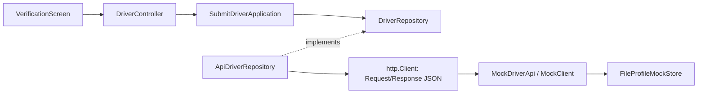
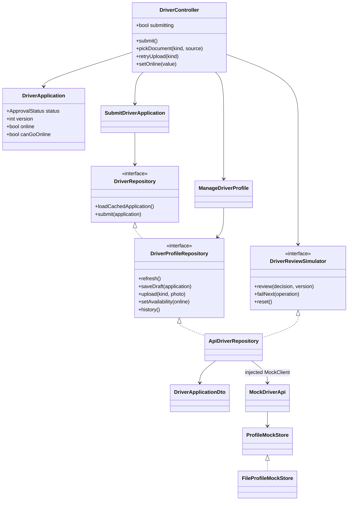

# Hồ sơ Driver với mock API — hướng dẫn thao tác và đọc source

> Tài liệu bản mock. App mặc định đã dùng backend thật: xem [hướng dẫn API](backend-api.md). Thêm `--dart-define=USE_MOCK_API=true` vào các lệnh demo bên dưới.

Phạm vi: **đăng ký hồ sơ → gửi duyệt → bổ sung giấy tờ → được duyệt → bật/tắt hoạt động**. Đây là phần hồ sơ Driver trong mobile, giữ BLoC/Cubit. Không triển khai nhận chuyến, giao hàng, ví, đăng nhập hoặc backend thật trong thay đổi này.

## 1. Chạy và demo

Tại thư mục `ModMove-mobile`:

```powershell
flutter pub get
flutter devices
flutter run
```

App mặc định mở Home. Bấm **Đăng ký tài xế** để vào form; **Tài khoản** để xem hồ sơ. Có thể mở trực tiếp form bằng `flutter run --dart-define=SCREEN=driver-onboarding`. Hai cách này khôi phục cùng dữ liệu mock đã lưu trên thiết bị.

Các giá trị SCREEN cũ như `verification-vehicle`, `profile-approved`, `profile-pending`, `profile-rejected` là fixture độc lập để review giao diện, không ghi đè hồ sơ lưu của luồng mặc định. Muốn đổi SCREEN, dừng và chạy lại app.

### Cách demo nhanh, khoảng 3–5 phút

1. Home → Đăng ký tài xế → **Mô phỏng** → **Tạo hồ sơ mẫu đầy đủ** → xác nhận **Tạo phiên mới**. Đây là cách dựng dữ liệu demo, không phải chức năng đăng ký tự động của hệ thống thật.
2. Bấm **Tiếp tục**, xem thông tin xe, bấm **Gửi hồ sơ xét duyệt**. UI có trạng thái đang xử lý và chuyển sang **Hồ sơ đang chờ duyệt**, phiên bản 1. Công tắc hoạt động bị khóa.
3. Bấm **Mô phỏng** → **Mô phỏng: yêu cầu bổ sung** → quay lại hồ sơ. Hai mục bị trả: **GPLX · Mặt sau** và **Giấy đăng kiểm**. Các giấy tờ đã được chấp nhận giữ nguyên và bị khóa.
4. Bấm **Cập nhật giấy tờ**. Ở mặt sau GPLX, chọn **Xem / Thay ảnh** → **Dùng ảnh mẫu mô phỏng**. Chờ tải xong, bấm **Tiếp tục**.
5. Ở giấy đăng kiểm, chọn **Thay ảnh** → **Dùng ảnh mẫu mô phỏng**. Bấm **Gửi hồ sơ xét duyệt**. Hồ sơ trở lại pending, phiên bản 2.
6. **Mô phỏng** → **Mô phỏng: duyệt hồ sơ** → quay lại. Bật **Sẵn sàng nhận đơn**. Chỉ đổi trạng thái thành công sau khi mock API trả kết quả.
7. Mở **Lịch sử các lần gửi**: phiên bản 2 được duyệt và phiên bản 1 bị trả lại vẫn có ảnh/lý do/quyết định riêng.

Các nút xét duyệt nằm trong màn hình **Kịch bản mô phỏng**, được ghi rõ là giả lập quản trị viên; tài xế không được coi là có quyền duyệt hồ sơ của mình trong hệ thống thật.

### Cách demo đăng ký từ đầu

Chọn **Mô phỏng → Bắt đầu đăng ký mới** và xác nhận. Điền dữ liệu thử:

| Trường | Giá trị mẫu |
| --- | --- |
| CCCD | `001201000123` |
| GPLX | `790123456789` |
| Loại xe | Xe tải 1 tấn |
| Biển số | `29C-123.45` |
| Tải trọng | `1000` kg |
| Dài × rộng × cao | `3,1` × `1,6` × `1,6` m |

Chọn đủ bảy ảnh: CCCD hai mặt, GPLX hai mặt, đăng ký xe, đăng kiểm và ảnh xe. Mỗi ô có camera, thư viện hoặc **Dùng ảnh mẫu mô phỏng**. Ảnh mẫu là hình trừu tượng có chữ DEMO; không phải giấy tờ của người thật.

**Lưu nháp** lưu thông tin đang nhập, kể cả chưa đủ/đúng để gửi duyệt. Chọn ảnh thành công tự lưu bản nháp; chuyển sang bước 2 hoặc quay ra khỏi bước 1 bằng nút Back cũng lưu nháp. Khi đang xử lý một yêu cầu, form khóa thao tác thay đổi dữ liệu. Tắt app trước khi lưu nháp có thể làm mất phần chữ vừa nhập chưa lưu.

## 2. Mock API thực chất hoạt động thế nào?



App tạo `http.Request`, gửi qua `http.Client`, nhận `http.Response`, xử lý mã HTTP và JSON. Client được inject là `MockClient`; request được xử lý **ngay trong process của app**, không gọi Internet và không cần chạy một server/port riêng. Độ trễ mặc định là 450 ms cho mỗi request để thấy trạng thái loading.

Địa chỉ `https://mock.modmove.local/v1` là base URL giả để mô phỏng đường đi HTTP. Không mở địa chỉ này trên trình duyệt. Các endpoint bên dưới là **hợp đồng mock đề xuất**, chưa phải contract backend Driver đã thống nhất.

| Method | Endpoint sau `/v1` | Nhiệm vụ |
| --- | --- | --- |
| GET | `/driver/application` | Tải hồ sơ mới nhất và trạng thái hoạt động |
| PUT | `/driver/draft` | Lưu dữ liệu nháp/bổ sung, không tạo phiên bản gửi mới |
| POST | `/driver/documents` | Nhận ảnh, kiểm tra, trả tham chiếu `mock://documents/...` |
| POST | `/driver/applications` | Kiểm tra rồi tạo một phiên bản pending; có Idempotency-Key |
| GET | `/driver/applications` | Danh sách phiên bản, mới nhất trước |
| PATCH | `/driver/availability` | Bật/tắt online theo quyền trên server mock |
| POST | `/demo/review` | Mô phỏng quyết định quản trị viên cho đúng phiên bản pending |
| POST | `/demo/failure` | Gây lỗi một lần cho thao tác được chọn |
| POST | `/demo/account` | Mô phỏng khóa/mở tài khoản |
| POST | `/demo/reset` | Tạo phiên mô phỏng mới, có xác nhận trong UI |

Ví dụ body gửi hồ sơ, đã rút gọn:

```json
{
  "version": 0,
  "status": "draft",
  "fields": { "citizenId": "001201000123", "license": "790123456789" },
  "documents": {
    "citizenFront": { "reference": "mock://documents/1", "fileName": "demo-document.png" }
  }
}
```

Body thật có đủ fields và bảy document. Mock dùng base64 cho ảnh để dễ lưu/replay cục bộ. API thật nên thống nhất multipart hoặc upload URL/signature; không giả định backend sẽ nhận đúng JSON này.

Response gửi thành công có `version` và `submittedAt`; lỗi có `message`, ví dụ 409 cho hồ sơ đã pending/phiên bản cũ, 422 cho dữ liệu không hợp lệ, 503 cho lỗi mô phỏng một lần. UI chỉ cập nhật trạng thái thành công khi nhận response hợp lệ.

## 3. Từ lúc mở app, các đối tượng được lắp theo thứ tự nào?

1. **`lib/main.dart`** khởi tạo Flutter. Với Home/driver-onboarding, app lấy application support directory bằng path_provider và đọc file mock đã lưu.
2. **`FileProfileMockStore.read()`** trả JSON lưu trước đó hoặc null khi chưa có dữ liệu.
3. **`MockDriverApi(...)`** khôi phục database mock hoặc tạo hồ sơ nháp mới; tạo `MockClient(_handle)`.
4. **`ModMoveApp._createDriver()` trong `lib/app/app.dart`** tạo `ApiDriverRepository`, truyền mock client và cache ban đầu vào repository.
5. App tạo `GetDriverApplication`, `SubmitDriverApplication(requireUploadedDocuments: true)`, `PickDocumentPhoto` và `ManageDriverProfile` rồi inject vào `DriverController`.
6. `MultiBlocProvider` giữ controller trên các route. Widget đọc controller bằng `context.read` khi xử lý hành động, và `context.watch` khi cần cập nhật UI.

Nếu dữ liệu lưu không đọc được, app hiện màn hình lỗi với **Thử lại** hoặc **Mở phiên tạm, không lưu**; không tự xóa dữ liệu cũ. Hồ sơ mặc định giả định người dùng đã có tài khoản Driver; phần đăng nhập/OTP không nằm trong phạm vi này.

## 4. Một chức năng chạy tuần tự: Gửi hồ sơ xét duyệt

Đây là luồng nên chọn để báo cáo. Đặt breakpoint theo thứ tự dưới đây rồi bấm nút gửi; mỗi bước tương ứng một trách nhiệm.

| Bước | File / hàm | Nội dung cần quan sát |
| --- | --- | --- |
| 1 | `presentation/screens/verification_screen.dart` — `_continue()` | Callback nút gửi; kiểm tra FormState và danh sách ảnh còn thiếu/chưa upload |
| 2 | `presentation/controllers/driver_controller.dart` — `submit()` | Chặn thao tác đồng thời, đặt submitting=true, emit(snapshot) |
| 3 | `domain/usecases/driver_usecases.dart` — `SubmitDriverApplication.call()` | Kiểm tra quyền sửa, dữ liệu cá nhân/xe, giấy tờ bị trả, tham chiếu upload |
| 4 | `data/repositories/api_driver_repository.dart` — `submit()` | Chuyển entity sang DTO; tạo/tái sử dụng Idempotency-Key cho cùng body |
| 5 | Cùng file — `_request()` | Tạo POST `/driver/applications`, gửi Request JSON và chờ response |
| 6 | `data/services/mock_driver_api.dart` — `_handle()` | Chờ độ trễ, xếp request vào hàng đợi xử lý tuần tự, giữ snapshot để rollback |
| 7 | Cùng file — `_route()` → `_submit()` | Kiểm tra dữ liệu theo trạng thái server; kiểm tra tham chiếu ảnh, phiên bản và request trùng |
| 8 | Cùng file — `_submit()` | Tạo version+1, submittedAt, status=pending, online=false; thêm lịch sử và receipt |
| 9 | `data/services/profile_mock_store.dart` — `write()` | Ghi JSON vào file tạm, flush và rename; lỗi ghi thì server mock rollback |
| 10 | `ApiDriverRepository._request()` → `submit()` | Nhận HTTP/JSON, chuyển thành ApplicationReceipt hoặc ApplicationFailure |
| 11 | `DriverController.submit()` | Cập nhật version/thời gian/pending; lấy lịch sử; finally tắt submitting và emit(snapshot) |
| 12 | `VerificationScreen._continue()` → callback trong `app.dart` | Thành công: pushReplacementNamed('/profile'); lỗi: giữ form và hiện thông báo |
| 13 | `DriverProfileScreen.build()` | context.watch nhận thay đổi; hiển thị pending và khóa công tắc hoạt động |

Các đường dẫn từ bước 1–11 nằm dưới `lib/features/onboarding/`, trừ app.dart/main.dart đã ghi riêng.

```mermaid
sequenceDiagram
    actor D as Tài xế
    participant V as VerificationScreen
    participant C as DriverController
    participant U as SubmitDriverApplication
    participant R as ApiDriverRepository
    participant M as MockDriverApi
    participant F as FileProfileMockStore
    D->>V: Bấm Gửi hồ sơ xét duyệt
    V->>V: Validate form + giấy tờ
    V->>C: submit()
    C->>C: submitting=true, emit(snapshot)
    C->>U: call(application snapshot)
    U->>U: Kiểm tra quy tắc nghiệp vụ
    U->>R: submit(application)
    R->>M: POST JSON + Idempotency-Key
    M->>M: Kiểm tra và tạo pending version
    M->>F: write(database)
    alt Lưu thành công
      F-->>M: Hoàn tất
      M-->>R: 200, version + submittedAt
      R-->>U: ApplicationReceipt
      U-->>C: receipt
      C->>C: pending, online=false, tắt busy
      C-->>V: null
      V->>V: Chuyển /profile
    else Lỗi ghi dữ liệu
      F-->>M: Exception
      M->>M: Rollback database
      M-->>R: 500 + message
      R-->>C: ApplicationFailure qua use case
      C-->>V: message, tắt busy trong finally
      V-->>D: Giữ form và cho thử lại
    end
```



Nhánh validation lỗi có thể dừng ngay ở screen/use case trước khi gửi request. API mock vẫn kiểm tra độc lập để không tin trạng thái/accepted/replaced từ client. Khi bấm gửi nhanh hai lần, controller chặn thao tác thứ hai; nếu request bị gửi lại qua transport với cùng key/body, API trả receipt cũ và không tạo phiên bản mới.

### Cách nói khoảng một phút

“Khi bấm gửi, VerificationScreen kiểm tra form rồi gọi DriverController.submit. Controller bật loading và đưa snapshot hồ sơ vào SubmitDriverApplication. Use case kiểm tra quy tắc, sau đó gọi interface DriverRepository. Implementation hiện tại là ApiDriverRepository: nó tạo POST JSON và Idempotency-Key. Request đi qua MockClient vào MockDriverApi. Mock API kiểm tra lại theo dữ liệu của nó, tạo phiên bản pending và lưu xuống file. Response được repository đổi thành ApplicationReceipt. Controller cập nhật state, emit(snapshot), rồi screen điều hướng sang hồ sơ chờ duyệt. Nếu lỗi, trạng thái busy được tắt trong finally và dữ liệu trên form được giữ để thử lại.”

## 5. Luồng tải ảnh và thử lại

1. `VerificationScreen._choose(kind)` mở lựa chọn camera/thư viện/ảnh mẫu.
2. `DriverController.pickDocument` gọi `PickDocumentPhoto`.
3. `DemoPhotoRepository` trả ảnh mẫu nếu chọn sample; các lựa chọn còn lại đi qua `DevicePhotoRepository` và image_picker. Adapter thiết bị kiểm tra dung lượng, signature và decode ảnh.
4. Controller giữ bytes local để preview, rồi `ManageDriverProfile.upload` gọi `ApiDriverRepository.upload`.
5. API tạo tham chiếu `mock://documents/N`; controller gắn tham chiếu vào document và lưu nháp.
6. Nếu upload lỗi, bytes vẫn còn, UI hiện **Chưa tải lên thành công / Thử tải lại**. `retryUpload` dùng lại bytes, không bắt chọn lại ảnh. App cố lưu ảnh local chưa upload vào bản nháp để khôi phục sau khi mở lại.
7. Có ảnh preview không đồng nghĩa upload thành công. Khi cần gửi, cả domain và mock API kiểm tra tham chiếu hợp lệ; bước cá nhân cũng không cho đi tiếp khi ảnh bắt buộc còn chưa upload.

Các file PNG/JPG được kiểm tra tối đa 5 × 1024 × 1024 byte. Kiểm tra định dạng/khả năng đọc ảnh không phải xác thực danh tính hay đọc hạn giấy tờ. Lý do “hết hạn” trong mô phỏng là quyết định mẫu.

## 6. Trạng thái, lịch sử và hoạt động

| Trạng thái | Nhập/sửa chữ | Thay ảnh | Gửi | Online |
| --- | --- | --- | --- | --- |
| draft | Có | Có | Khi đủ dữ liệu và ảnh upload | Không |
| pending | Khóa | Khóa | Không tạo thêm phiên bản pending | Không |
| rejected | Giữ thông tin đã xét duyệt | Chỉ mục chưa accepted | Phải thay đủ ảnh bị trả | Không |
| approved | Khóa | Khóa | Không gửi lại | Chỉ khi accountActive=true |

Mỗi lần gửi hợp lệ tăng version; lưu nháp/upload không tăng version. Quyết định duyệt ghi vào đúng phiên bản pending. Sau khi đã quyết định, bổ sung sẽ tạo phiên bản tiếp theo; dữ liệu/quyết định của phiên bản cũ vẫn giữ nguyên.

`canGoOnline` là quyền, còn `online` là trạng thái công tắc. Sau khi duyệt mock, tài xế vẫn offline cho đến khi chủ động bật. Bật/tắt gọi PATCH; lỗi thì giữ giá trị cũ và hiện thông báo. Mô phỏng khóa tài khoản sẽ ép offline. Mở khóa trở lại không tự bật online.

## 7. Các tình huống lỗi để trình bày

| Tình huống | Cách tạo | Kết quả cần thấy |
| --- | --- | --- |
| Thiếu dữ liệu | Để trống CCCD/GPLX hoặc kích thước | Báo lỗi, không gửi |
| Trùng dữ liệu | CCCD/GPLX `999999999999` hoặc biển số `99C-999.99` | Mock trả 409, giữ form |
| Upload lỗi | Mô phỏng → Lỗi tải ảnh lần tới → chọn/thay ảnh | Giữ preview, hiện Thử tải lại; retry thành công |
| Gửi lỗi | Mô phỏng → Lỗi gửi hồ sơ lần tới → Gửi | Giữ draft/rejected; thử lại tạo đúng một pending version |
| Tải trạng thái lỗi | Đặt lỗi tải trạng thái → nút refresh trên hồ sơ | Hiện lỗi, không đoán trạng thái mới |
| Tài khoản bị khóa | Hồ sơ approved → Mô phỏng → tắt tài khoản hoạt động | Offline, không bật được online |
| Sửa mục accepted | Hồ sơ rejected → mở mục đã chấp nhận | Chỉ xem; mock API cũng từ chối upload vào mục này |
| Bổ sung thiếu | Chỉ thay một trong hai ảnh bị trả | Chưa thể gửi lại |
| Gửi lặp | Bấm gửi nhanh/liên tiếp; test đồng thời ở API | Chỉ một phiên bản pending |

## 8. Lưu trữ và giới hạn mô phỏng

Mock database lưu ở application support directory của app, tên `driver-profile-mock-v1.json`. Có hồ sơ hiện tại, file ảnh mã hóa base64, các phiên bản và receipt chống gửi trùng. App Android bình thường lưu lại khi save/upload/submit/review/availability thành công; khởi động lại không tự xóa fixture đang làm.

Đây là dữ liệu mô phỏng trong sandbox ứng dụng; không có Cloudinary, database server, xác thực JWT hay Admin thật. Khi có backend, cần thống nhất endpoint, auth, upload và DTO; inject client/service thật vào app composition, bỏ simulator. Không chỉ đổi base URL rồi mặc định coi là đã tích hợp đúng.

## 9. Kiểm thử và các file cần mở

```powershell
flutter analyze --no-fatal-infos
flutter test --coverage
flutter build apk --debug
```

`test/driver_mock_api_test.dart`: vòng đời hai phiên bản; chặn quyền; request trùng/đồng thời; không tin cờ accepted do client gửi; lỗi một lần; rollback khi lưu lỗi; khôi phục từ file thật.

`test/driver_mock_flow_test.dart`: giữ ảnh khi upload lỗi; retry không mở lại picker; controller chặn submit đang chạy; widget test bấm toàn bộ luồng đăng ký → bổ sung → duyệt → online; thử lỗi từ UI rồi retry.

Các test cũ tiếp tục kiểm tra form, profile, navigation, responsive và render. Widget test dùng mock transport trong môi trường Flutter test; không gọi đây là kiểm thử backend thật. Kết quả chạy và kiểm tra APK của lần bàn giao nằm trong `../output/driver-profile-mock/evidence/`.

Kết quả ngày **07/11/2026**: `flutter analyze` không có issue; **53/53 test đạt**; build APK debug thành công (23:09–23:11, UTC+07). Kiểm tra trực tiếp trên **Android 16 / API 36 emulator** đã đi từ form, dùng hồ sơ mẫu đầy đủ để gửi version 1, mô phỏng trả lại, tải hai ảnh mẫu thay thế, gửi version 2, duyệt và bật hoạt động. Sau force-stop rồi mở lại, app vẫn giữ approved/version 2/online, hai bản lịch sử và bytes ảnh đã tải lên. Kết quả lưu tại `android-smoke-result.json`; ảnh có giờ chụp và SHA-256 trong `android-screenshots.json` (hoàn tất lúc 23:20, UTC+07).

Luồng nhập từ đầu và tải đủ bảy ảnh được kiểm tra bằng widget test. Lần kiểm tra Android dùng fixture cho lần gửi đầu; camera/thư viện trên điện thoại thật và backend thật chưa được kiểm tra trong lần này.

Điểm đặt breakpoint nên chọn: `_continue`, `DriverController.submit`, `SubmitDriverApplication.call`, `ApiDriverRepository.submit`, `_request`, `MockDriverApi._handle`, `_submit`, `FileProfileMockStore.write`. Dùng **Step Into** để đi vào hàm, **Step Over** để chạy qua lời gọi; với async, quan sát Call Stack và biến trước/sau await. Không đưa base64 ảnh lớn lên slide; chỉ xem kind, reference, status, version và HTTP status.

## 10. Class diagram và các khái niệm cần giải thích



Sơ đồ rút gọn các lớp của luồng hồ sơ. Mũi tên nét đứt tam giác thể hiện implementation; mũi tên thường thể hiện sử dụng/phụ thuộc. Mối nối repository → mock API mô tả đường chạy qua client được inject, không có import trực tiếp từ repository sang MockDriverApi. `DriverProfileRepository implements DriverRepository` bổ sung hợp đồng async; Dart dùng `implements`, không tái sử dụng implementation bằng `extends`.

| Khái niệm | Giải thích bằng source hiện tại |
| --- | --- |
| Feature-first | Code hồ sơ nằm trong `features/onboarding`; mỗi feature chia presentation/domain/data. Mở một chức năng không phải đi tìm trong một thư mục screens chung của toàn app. |
| Presentation | Screen/widget nhận thao tác và render; DriverController quản lý trạng thái loading, lỗi, hồ sơ và điều phối use case. |
| Domain | Entity, hợp đồng repository và quy tắc nghiệp vụ bằng Dart; không import Flutter, HTTP, image_picker hay path_provider. |
| Data | DTO, repository implementation, mock transport và file store. Lớp này biết JSON, mã HTTP và cách lưu dữ liệu. |
| Entity | `DriverApplication`/`VerificationDocument` là dữ liệu và quyền nghiệp vụ; không tự gọi mạng hoặc vẽ giao diện. |
| DTO | `DriverApplicationDto` ánh xạ entity sang JSON và ngược lại; ví dụ DateTime sang chuỗi ISO, bytes sang base64. |
| Repository | Hợp đồng domain cho việc lấy/lưu/gửi hồ sơ. Use case gọi hợp đồng; app inject ApiDriverRepository để thực hiện. |
| Use case | Một hành động hoặc nhóm thao tác nghiệp vụ. `SubmitDriverApplication` kiểm tra điều kiện gửi trước khi gọi repository. |
| Dependency injection | `app.dart` tạo repository/use case và truyền qua constructor; controller không tự tạo HTTP client. Tests thay bằng mock/fake và bỏ độ trễ. |
| BLoC / Cubit | BlocProvider cung cấp Cubit cho cây widget; `emit(snapshot)` báo state đổi, `context.watch` làm widget build lại. `context.read` lấy controller để gọi hành động mà không đăng ký rebuild. |
| Future / async / await | Gửi request trả Future; await đợi kết quả mà không cố định một giá trị thành công trước. UI dùng busy/loading và try/catch/finally để phản ánh quá trình. |
| Mock và fixture | Mock mô phỏng hành vi/API, trạng thái và lỗi. Fixture là bộ dữ liệu khởi đầu cố định như profile-pending; một ảnh giao diện fixture không chứng minh toàn bộ luồng thao tác. |
| Idempotency | Cùng key và cùng body được gửi lại sẽ nhận cùng receipt. Mục tiêu là tránh tạo thêm phiên bản do retry; khóa nút ở UI chỉ là một lớp phòng ngừa. |
| Version và lịch sử | Mỗi lần gửi tăng version; lưu nháp không tăng. Lịch sử lưu snapshot, nên thay ảnh của bản bổ sung không sửa ngược ảnh của phiên bản bị trả. |

Khi giải thích Clean Architecture, nhấn mạnh **hướng phụ thuộc**: domain định nghĩa interface; data thực hiện interface; app lắp các đối tượng. Không chỉ nói “có ba folder” là đủ.

## 11. Kịch bản báo cáo và câu hỏi thường gặp

Phần trình bày khoảng 7 phút:

1. **30 giây — phạm vi:** mobile Driver, đăng ký/xét duyệt/bổ sung/hoạt động; backend Driver chưa có nên dùng mock transport và lưu cục bộ.
2. **2 phút — demo:** tạo hồ sơ đầy đủ, gửi version 1, mô phỏng trả hai ảnh, thay ảnh, gửi version 2, duyệt rồi bật hoạt động.
3. **2 phút — đọc code:** mở các breakpoint trong mục 4; chỉ ra UI → controller → use case → repository → mock API → file → response → UI.
4. **1 phút — kiến trúc:** dùng class diagram để chỉ interface và implementation, lý do domain không phụ thuộc thư viện giao diện/mạng.
5. **1 phút — kiểm thử:** mở test và log, trình diễn upload lỗi/thử lại; đưa ảnh bằng chứng có thời điểm chụp.
6. **30 giây — giới hạn:** API/duyệt là mô phỏng; camera/thư viện, backend thật và nhiều thiết bị cần kiểm thử tích hợp riêng.

**“Chưa có backend thì em đang gọi API gì?”** — “Em tạo Request/Response HTTP và JSON qua MockClient chạy trong app. Nó có endpoint, validation, lỗi, trạng thái và lưu dữ liệu; chưa có request tới server thật.”

**“Vì sao kiểm tra ở cả use case và mock API?”** — “Use case cho phản hồi sớm trên mobile. Phía xử lý API kiểm tra độc lập để không tin dữ liệu/cờ duyệt do client gửi. Khi có backend thật, phần bảo vệ phía server phải được backend thực hiện.”

**“Vì sao approved chưa tự online?”** — “Được duyệt là đủ điều kiện; online là lựa chọn của tài xế. Tài khoản cũng phải đang hoạt động, rồi PATCH thành công mới đổi công tắc.”

**“Nếu đang gửi mà bấm lại?”** — “Controller chặn khi busy; API dùng Idempotency-Key. Test đồng thời kiểm tra chỉ tạo một pending version.”

**“Nếu đóng ứng dụng?”** — “Các thao tác lưu thành công đã ghi xuống application support directory. Mở lại đọc file đó. Chữ đang gõ chưa bấm lưu có thể chưa được giữ.”

**“Đổi sang API thật có phải viết lại màn hình không?”** — “Màn hình vẫn gọi use case qua controller; thay data implementation/composition. Cần đối chiếu contract, auth, upload và DTO, không chỉ đổi URL.”
